# Architecture

A product management application with three parts: an Express + TypeScript API, an admin dashboard for inventory, and a customer storefront (both in one React app). PostgreSQL is the system of record.

The central requirement is that **the buy endpoint must never oversell, even under heavy concurrency**. That guarantee is enforced by the database, not by application code, and it is proven by tests that fire up to 100 simultaneous purchases at one product.

```
┌──────────────────────────┐      /api/*       ┌──────────────────────┐       SQL        ┌──────────────┐
│ React (Vite)             │ ────────────────▶ │ Express API          │ ───────────────▶ │ PostgreSQL   │
│  • Storefront (customer) │   JSON + JWT      │  • auth, RBAC        │   pooled (20)    │  constraints │
│  • Inventory (admin)     │ ◀──────────────── │  • validation (zod)  │ ◀─────────────── │  row locks   │
└──────────────────────────┘                   └──────────────────────┘                  └──────────────┘
```

## 1. Database schema

Defined in [`backend/db/schema.sql`](backend/db/schema.sql).

```mermaid
erDiagram
  users ||--o{ orders : places
  products ||--o{ orders : "is bought in"
  users {
    bigint id PK
    text email "unique, case-insensitive"
    text password_hash "bcrypt"
    user_role role "admin | customer"
  }
  products {
    bigint id PK
    text sku UK
    text name
    int price_cents "CHECK >= 0"
    int stock "CHECK >= 0"
    bool is_active "soft delete"
    int version "optimistic lock"
  }
  orders {
    bigint id PK
    bigint user_id FK
    bigint product_id FK
    int quantity "CHECK > 0"
    int unit_price_cents "price snapshot"
    int total_cents "CHECK = unit x qty"
    text idempotency_key "UNIQUE per user"
  }
```



| Decision | Why |
| --- | --- |
| `CHECK (stock >= 0)` on `products` | A last line of defence. Even if a future code change introduced a bug, the database rejects any write that would make stock negative. |
| Money stored as integer cents | Avoids floating-point rounding errors (`0.1 + 0.2 != 0.3`). |
| `orders.unit_price_cents` snapshot | An admin changing a price later never rewrites what a customer actually paid. |
| `CHECK (total_cents = unit_price_cents * quantity)` | The database refuses an internally inconsistent order. |
| `UNIQUE (user_id, idempotency_key)` | Guarantees one order per checkout attempt, even when a retry races the original request. |
| Soft delete via `is_active` | Orders reference products by foreign key. Hard-deleting a product would either fail or destroy order history. |
| Case-insensitive unique index on `lower(email)` | `Alice@x.com` and `alice@x.com` can't become two accounts. |
| `version` column | Optimistic locking for admin edits (see 2.3). |

## 2. Concurrency strategy

### 2.1 The problem

The obvious implementation of "buy" is:

```ts
const { stock } = await db.query('SELECT stock FROM products WHERE id = $1')
if (stock < quantity) throw new Error('Out of stock')
await db.query('UPDATE products SET stock = $1 WHERE id = $2', [stock - quantity, id])
```

There is a gap between the read and the write. Two customers buying the last unit can both read `stock = 1`, both pass the check, and both write `stock = 0`. Two orders are created for one unit. This is a classic **check-then-act race condition**, and wrapping it in a transaction does not fix it: under PostgreSQL's default `READ COMMITTED` isolation, both transactions still read the same value.

The test suite includes this naive version as a control experiment ([`purchase.concurrency.test.ts`](backend/tests/purchase.concurrency.test.ts)). With 20 concurrent buyers and 10 units, it creates more than 10 orders on every run, which proves the tests can detect overselling.

### 2.2 The solution: one atomic conditional UPDATE

[`backend/src/services/purchase.ts`](backend/src/services/purchase.ts) makes the check and the decrement a single statement:

```sql
BEGIN;

UPDATE products
   SET stock = stock - $qty
 WHERE id = $id AND is_active AND stock >= $qty
RETURNING price_cents;
-- 0 rows returned → not enough stock → ROLLBACK, respond 409

INSERT INTO orders (user_id, product_id, quantity, unit_price_cents, total_cents, idempotency_key)
VALUES (...);

COMMIT;
```

Why this is safe:

1. **Row lock.** PostgreSQL locks the product row before modifying it. Concurrent buyers of the same product queue on that lock; buyers of different products are unaffected.
2. **Re-check after waiting.** When a queued `UPDATE` acquires the lock, PostgreSQL re-evaluates its `WHERE` clause against the latest committed version of the row. If an earlier buyer took the last unit, `stock >= $qty` is now false, zero rows are updated, and the API returns `409 INSUFFICIENT_STOCK`.
3. **No gap.** There is no moment where the application holds a stale stock value, because the application never reads stock to make the decision.
4. **All or nothing.** The decrement and the order insert share one transaction. If the insert fails, the decrement is rolled back.
5. **Defence in depth.** `CHECK (stock >= 0)` makes overselling impossible at the storage level even if this query were changed incorrectly.

The lock is held only for the duration of one short transaction (one `UPDATE` and one `INSERT`, no network calls in between), so contention stays low.

### 2.3 Other writes that touch the same data

| Operation | Strategy | Why |
| --- | --- | --- |
| Admin restock / write-off | `UPDATE products SET stock = stock + $delta` | Applied as a **delta**, so it composes with concurrent purchases. Stock is deliberately not editable as an absolute number: an admin who loaded "stock: 10" and saves "15" would silently erase any purchases made in between (a *lost update*). A delta that would go below zero hits the `CHECK` constraint and is rejected with 409. |
| Admin edits name, price, description | **Optimistic locking** with `version`. The client sends the version it loaded; `UPDATE ... WHERE id = $1 AND version = $2`. If another admin saved first, zero rows match and the API returns `409 VERSION_CONFLICT`. | Admin edits are rare and conflicts even rarer, so holding locks while someone fills in a form would be wasteful. Purchases do not bump `version`, so customers buying stock never cause an admin's edit to fail. |
| Retried purchase (double click, network retry) | **Idempotency key.** The client sends an `Idempotency-Key` header, kept until the server answers. A retry returns the original order with `200` instead of buying again. | If two identical requests race, both may pass the initial "already exists?" check, but the `UNIQUE (user_id, idempotency_key)` constraint lets only one commit. The loser's whole transaction, including its stock decrement, rolls back, and it returns the winner's order. |

### 2.4 Alternatives considered

| Approach | How it works | Why not chosen |
| --- | --- | --- |
| **Pessimistic lock:** `SELECT ... FOR UPDATE`, check in code, then `UPDATE` | Explicitly locks the row before reading it | Also correct, and a good choice when the business rule is too complex for a `WHERE` clause (for example, per-customer purchase limits across several tables). For a simple stock check it adds a round trip and holds the lock longer for no gain. |
| **Optimistic locking for purchases** (version column, retry on conflict) | No lock; detect conflicts and retry | Under contention for a hot product (a flash sale), most attempts conflict and retry, wasting work. Optimistic locking suits rare conflicts, which is why it's used for admin edits instead. |
| **`SERIALIZABLE` isolation** | PostgreSQL aborts transactions that would produce an anomaly | Correct, but the application must catch serialization failures and retry, and it's heavier than needed for a single-row invariant. |
| **Application-level lock** (in-memory mutex, Redis lock) | Serialise buyers outside the database | An in-memory mutex breaks as soon as there is more than one API instance. A distributed lock adds a new failure mode (lock expiry while the holder is still working) and still needs the database to be correct anyway. |
| **Queue all purchases** (single consumer) | One worker processes orders in sequence | Excellent for extreme flash-sale scale, but the buy endpoint becomes asynchronous ("order received, pending"), which is unnecessary complexity here. |

### 2.5 How it's proven

[`backend/tests/purchase.concurrency.test.ts`](backend/tests/purchase.concurrency.test.ts) runs against a real PostgreSQL database through the real HTTP API:

| Scenario | Expected result |
| --- | --- |
| 100 buyers, 1 unit each, 10 in stock, all at once | exactly 10 × `201`, 90 × `409`, stock 0, 10 units in orders |
| 30 buyers, 3 units each, 10 in stock | exactly 3 succeed, stock 1 |
| 50 purchases racing 10 admin restocks | stock + units sold = initial + restocked (nothing lost or invented) |
| Same idempotency key sent 20 times at once | exactly 1 order, stock decremented once |
| Control: naive read-then-write version | oversells (more than 10 orders for 10 units) |

The suite was run repeatedly with identical results, so the passing results aren't a lucky timing.

## 3. API

| Method | Path | Access | Notes |
| --- | --- | --- | --- |
| POST | `/api/auth/register` | public | Always creates a `customer` |
| POST | `/api/auth/login` | public | Returns a JWT; rate-limited |
| GET | `/api/auth/me` | signed in | |
| GET | `/api/products` | public | Active products only |
| GET | `/api/products/:id` | public | |
| POST | `/api/orders` | customer | Body `{ productId, quantity }`; optional `Idempotency-Key` header. `201` created, `200` replayed, `409` insufficient stock |
| GET | `/api/orders/mine` | signed in | |
| GET | `/api/admin/products` | admin | Includes inactive products |
| GET | `/api/admin/products/:id` | admin | |
| POST | `/api/admin/products` | admin | `409` on duplicate SKU |
| PATCH | `/api/admin/products/:id` | admin | Requires `version`; rejects `stock` |
| POST | `/api/admin/products/:id/stock-adjustments` | admin | Body `{ delta }` |
| DELETE | `/api/admin/products/:id` | admin | Soft delete |
| GET | `/api/admin/orders` | admin | 100 most recent |

Errors share one shape: `{ "error": { "code": "INSUFFICIENT_STOCK", "message": "...", "details": {...} } }`.

## 4. Security

- **Passwords** are hashed with bcrypt. Login runs a bcrypt comparison even for unknown emails, so response time doesn't reveal which emails have accounts.
- **Role-based access** is enforced by middleware on every API route. The React route guards only control navigation; they are not a security boundary.
- **Roles are re-read from the database on each request** rather than trusted from the JWT, so demoting an admin takes effect immediately instead of when their token expires. Cost: one primary-key lookup per request.
- **JWTs** are signed with HS256, and verification pins the algorithm.
- **Input validation** with zod on every body and parameter; unknown fields are rejected where they matter (stock can't sneak into a product edit).
- **SQL injection:** every query is parameterised.
- **Other:** `helmet` security headers, CORS restricted to the frontend origin, 100 KB body limit, rate limiting on auth endpoints.

## 5. Technical trade-offs

| Choice | Benefit | Cost / what I'd revisit |
| --- | --- | --- |
| **TypeScript + Express** | My strongest stack, so I could deliver quickly and explain every line. The concurrency guarantees live in PostgreSQL, so they'd be identical from Java or Go. | Express is unopinionated; a larger team might prefer NestJS's enforced structure. |
| **Raw SQL with `pg`, no ORM** | The locking behaviour is visible and reviewable in the code, which matters for the core requirement. | More boilerplate; no automatic migrations. A real project would add a migration tool (for example, node-pg-migrate). |
| **Atomic UPDATE vs `SELECT ... FOR UPDATE`** | Fewest round trips, shortest lock time. | Only works when the rule fits in a `WHERE` clause. |
| **JWT in `localStorage`** | Simple, stateless. | Readable by any script on the page if an XSS bug slipped in. Production should use an `httpOnly`, `SameSite` cookie plus CSRF protection, and support token revocation. |
| **Synchronous purchases** | Immediate, simple answer for the customer. | A very hot product serialises on one row lock. At flash-sale scale I'd consider a queue or splitting stock into several rows ("buckets"). |
| **One order = one product** | Keeps the core path simple. | A real cart needs order line items. Locking several products in one transaction must then lock rows in a consistent order (for example, by product id) to avoid deadlocks. |
| **Hard-coded USD, no payments** | In scope for the exercise. | A real checkout would reserve stock, take payment, and release the reservation if payment fails. |

## 6. What I'd add next

1. Order line items (multi-product cart) with deadlock-safe lock ordering.
2. Payment integration with stock reservations that expire.
3. `httpOnly` cookie sessions and refresh tokens.
4. A proper migration tool and CI running the test suite against PostgreSQL.
5. Pagination and search for products and orders; an audit log of stock adjustments.
