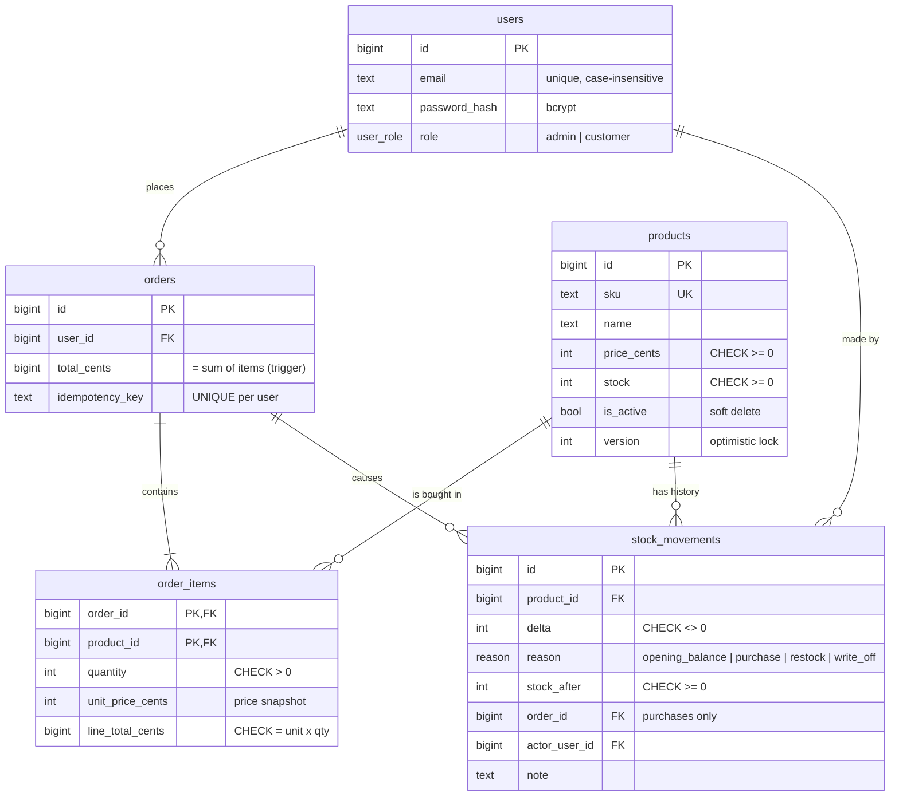

# Architecture

A product management application with three parts: an Express + TypeScript API, an admin dashboard for inventory, and a customer storefront (both in one React app). PostgreSQL is the system of record.

The central requirement is that **the buy endpoint must never oversell, even under heavy concurrency**. Customers buy a whole cart at once, so the guarantee is stronger than "no negative stock": a cart is bought completely or not at all, carts can't deadlock each other, and every unit of stock is accounted for in an append-only ledger. These guarantees are enforced by the database, not only by application code, and the tests prove them with up to 100 simultaneous purchases.

```
┌──────────────────────────┐      /api/*       ┌──────────────────────┐       SQL        ┌────────────────────┐
│ React (Vite)             │ ────────────────▶ │ Express API          │ ───────────────▶ │ PostgreSQL         │
│  • Storefront + cart     │   JSON + JWT      │  • auth, RBAC        │   pooled (20)    │  • constraints     │
│  • Inventory, history    │ ◀──────────────── │  • validation (zod)  │ ◀─────────────── │  • row locks       │
└──────────────────────────┘                   └──────────────────────┘                  │  • ledger, triggers│
                                                                                         └────────────────────┘
```

## 1. Database schema

Defined by the migrations in [`backend/db/migrations`](backend/db/migrations) (see §4).



| Decision | Why |
| --- | --- |
| `CHECK (stock >= 0)` on `products` | A last line of defence. Even if a future code change introduced a bug, the database rejects any write that would make stock negative. |
| Money stored as integer cents; order totals as `BIGINT` | Integers avoid floating-point rounding errors (`0.1 + 0.2 != 0.3`). Totals are 64-bit because a 32-bit integer tops out at about $21 million in cents, which a large cart could exceed. A test buys $100 million to prove it. |
| `order_items.unit_price_cents` snapshot | An admin changing a price later never rewrites what a customer actually paid. |
| `PRIMARY KEY (order_id, product_id)` on `order_items` | One line per product per order. The API rejects a cart that lists a product twice. |
| Deferred constraint trigger: order total = sum of its items | A `CHECK` can't look across two tables, so a trigger does it. It is **deferred to commit time** because the order and its items are inserted by separate statements; the check runs once they all exist, and a mismatch (or an order with no items) rejects the whole transaction. |
| `UNIQUE (user_id, idempotency_key)` | Guarantees one order per checkout attempt, even when a retry races the original request. |
| Soft delete via `is_active` | Orders and ledger entries reference products. Hard-deleting a product would either fail or destroy history. |
| Case-insensitive unique index on `lower(email)` | `Alice@x.com` and `alice@x.com` can't become two accounts. |
| `version` column | Optimistic locking for admin edits (§2.5). |
| `stock_movements` ledger | Explains every change to stock. Append-only and self-checking (§3). |

## 2. Concurrency strategy

### 2.1 The problem

The obvious implementation of "buy" is:

```ts
const { stock } = await db.query('SELECT stock FROM products WHERE id = $1')
if (stock < quantity) throw new Error('Out of stock')
await db.query('UPDATE products SET stock = $1 WHERE id = $2', [stock - quantity, id])
```

There is a gap between the read and the write. Two customers buying the last unit can both read `stock = 1`, both pass the check, and both write `stock = 0`. Two orders are created for one unit. This is a classic **check-then-act race condition**, and wrapping it in a transaction does not fix it: under PostgreSQL's default `READ COMMITTED` isolation, both transactions still read the same value.

A cart adds two more problems:

- **Partial purchases.** If a cart of A and B gets A but B has run out, the customer must not be left with half an order and A's stock must come back.
- **Deadlocks.** A transaction keeps each row lock until it commits, so a cart holds several locks at once. If one buyer locks A and then waits for B, while another has locked B and waits for A, neither can ever continue.

### 2.2 The solution

[`backend/src/services/purchase.ts`](backend/src/services/purchase.ts) runs the whole checkout as one transaction:

```sql
BEGIN;

-- For each line, in ascending product id order:
UPDATE products
   SET stock = stock - $qty
 WHERE id = $id AND is_active AND stock >= $qty
RETURNING price_cents, stock;
-- 0 rows → that line can't be fulfilled → ROLLBACK the whole cart, respond 409

INSERT INTO orders (user_id, total_cents, idempotency_key) VALUES (...);
INSERT INTO order_items (...) SELECT ... FROM unnest(...);   -- all lines, one statement
INSERT INTO stock_movements (...) VALUES (...);              -- one per line (§3)

COMMIT;  -- deferred trigger checks total = sum of items here
```

Why this is safe:

1. **No oversell: check and decrement are one statement.** PostgreSQL locks the product row before modifying it, so concurrent buyers of a product queue on that lock. When a queued `UPDATE` acquires the lock, PostgreSQL re-evaluates its `WHERE` clause against the latest committed row. If an earlier buyer took the last unit, `stock >= $qty` is now false, zero rows are updated, and nothing is sold. The application never reads stock to make the decision, so there is no stale value to act on.
2. **All or nothing.** Every line, the order, its items and the ledger entries share one transaction. If any line fails, the rollback restores the stock already taken for earlier lines.
3. **No deadlocks: a global lock order.** Lines are always processed in ascending product id order, whatever order the customer added them in. Every transaction therefore acquires its locks in the same sequence. A transaction can wait for a lock on a higher id, but never for one on a lower id, so a cycle of transactions waiting for each other can't form.
4. **Defence in depth.** `CHECK (stock >= 0)` makes overselling impossible at the storage level even if the query were changed incorrectly, and the deferred trigger refuses an inconsistent order.

Locks are held only for one short transaction (a few `UPDATE`s and `INSERT`s, no network calls in between), so contention stays low. Buyers of different products never wait for each other.

When a cart is rejected, the API explains which lines were short (`{ productId, name, requested, available }`). That explanation is read **after** the rollback and decides nothing; it is only a message.

### 2.3 Deadlocks, concretely

Without the sort, this interleaving deadlocks:

```
Transaction 1                       Transaction 2
UPDATE product A   (locks A)
                                    UPDATE product B   (locks B)
UPDATE product B   (waits for 2)
                                    UPDATE product A   (waits for 1)   → cycle
```

PostgreSQL detects the cycle after about a second and aborts one transaction with error `40P01`, so a customer would see a random failure. With the sort, both transactions start with A; Transaction 2 simply waits for Transaction 1 to finish, then proceeds.

The test suite proves both halves: a control experiment that locks in request order does produce `40P01`, and 40 concurrent carts listing the same two products in opposite orders all succeed. Removing the sort from the real code makes that second test fail with deadlock errors.

### 2.4 Idempotency

The client sends an `Idempotency-Key` header with each checkout attempt and keeps it until the server answers, so a retry after a network failure returns the original order (`200`) instead of buying again.

If two identical requests race, both may pass the initial "already exists?" check, but `UNIQUE (user_id, idempotency_key)` lets only one commit. The loser's whole transaction, including its stock decrements, rolls back, and it returns the winner's order.

Reusing a key for a **different** cart is a client bug, so the API answers `422 IDEMPOTENCY_KEY_REUSED` rather than silently returning an unrelated order.

### 2.5 Other writes that touch the same data

| Operation | Strategy | Why |
| --- | --- | --- |
| Admin restock / write-off | `UPDATE products SET stock = stock + $delta` | Applied as a **delta**, so it composes with concurrent purchases. Stock is deliberately not editable as an absolute number: an admin who loaded "stock: 10" and saves "15" would silently erase any purchases made in between (a *lost update*). A delta that would go below zero hits the `CHECK` constraint and is rejected with 409. Locks one row, so it can't take part in a deadlock. |
| Admin edits name, price, description | **Optimistic locking** with `version`. The client sends the version it loaded; `UPDATE ... WHERE id = $1 AND version = $2`. If another admin saved first, zero rows match and the API returns `409 VERSION_CONFLICT`. | Admin edits are rare and conflicts even rarer, so holding locks while someone fills in a form would be wasteful. Purchases do not bump `version`, so customers buying stock never cause an admin's edit to fail. |

### 2.6 Alternatives considered

| Approach | How it works | Why not chosen |
| --- | --- | --- |
| **Pessimistic lock:** `SELECT ... FOR UPDATE ORDER BY id`, check in code, then `UPDATE` | Locks every cart row up front, then decides | Also correct and deadlock-safe, and the better choice when the rule is too complex for a `WHERE` clause (for example, per-customer purchase limits). For a stock check it adds a round trip and holds locks longer for no gain. |
| **One `UPDATE ... FROM unnest(...)` for the whole cart** | Fewer round trips | PostgreSQL doesn't guarantee the order in which a multi-row `UPDATE` locks rows, which would bring deadlocks back. |
| **Optimistic locking for purchases** (version column, retry on conflict) | No lock; detect conflicts and retry | Under contention for a hot product (a flash sale), most attempts conflict and retry, wasting work. It suits rare conflicts, which is why it's used for admin edits instead. |
| **`SERIALIZABLE` isolation** | PostgreSQL aborts transactions that would produce an anomaly | Correct, but every caller must catch serialization failures and retry, and it's heavier than needed for these invariants. |
| **Catch deadlocks and retry** | Let them happen; retry on `40P01` | Treats the symptom. Each deadlock still costs about a second before detection. Lock ordering removes the cause. |
| **Application-level lock** (in-memory mutex, Redis lock) | Serialise buyers outside the database | An in-memory mutex breaks as soon as there is more than one API instance. A distributed lock adds a new failure mode (lock expiry while the holder is still working) and still needs the database to be correct anyway. |
| **Queue all purchases** (single consumer) | One worker processes orders in sequence | Excellent for extreme flash-sale scale, but checkout becomes asynchronous ("order received, pending"), which is unnecessary complexity here. |

### 2.7 How it's proven

[`backend/tests/purchase.concurrency.test.ts`](backend/tests/purchase.concurrency.test.ts) runs against a real PostgreSQL database through the real HTTP API. After every scenario, the test also checks that the ledger still balances (§3).

| Scenario | Expected result |
| --- | --- |
| 100 buyers, 1 unit each, 10 in stock, all at once | exactly 10 × `201`, 90 × `409`, stock 0 |
| 30 buyers, 3 units each, 10 in stock | exactly 3 succeed, stock 1 |
| 50 carts of A + B; A has 30, B has 10 | exactly 10 succeed; A ends at 20, not 0: failed carts gave their unit of A back |
| 40 carts listing A and B in opposite orders | all 40 succeed, no deadlocks |
| 50 purchases racing 10 admin restocks | stock + sold = initial + restocked, and each ledger entry's `stock_after` = previous + delta |
| Same idempotency key sent 20 times at once | exactly 1 order, stock decremented once |
| **Control:** naive read-then-write version | oversells (more than 10 orders for 10 units) |
| **Control:** locking in request order | PostgreSQL aborts a transaction with deadlock error `40P01` |

The control experiments show that the tests can detect each bug, so a passing run means something. The suite was run repeatedly with identical results.

## 3. Inventory ledger

`products.stock` says how many units there are. The `stock_movements` table says **why**. Every change to stock is recorded as a movement, in the **same transaction** as the change, so the two can never disagree:

| Reason | Direction | Recorded by |
| --- | --- | --- |
| `opening_balance` | + | Product creation (and the migration that introduced the ledger) |
| `purchase` | − | Checkout, one per order line, linked to the order |
| `restock` | + | Admin adjustment, with an optional note |
| `write_off` | − | Admin adjustment (damage, loss), with an optional note |

Each movement also stores who made it and `stock_after`, the stock level right after it, so a product's history can be read line by line.

The database protects the ledger itself:

- **Append-only.** A trigger rejects any `UPDATE` or `DELETE`. As in accounting, a mistake is fixed with a new, compensating movement, never by editing history.
- **Consistent reasons.** A `CHECK` constraint ties each reason to its direction, and only purchases may link to an order. A "restock" that removes stock is refused.

**Reconciliation.** The invariant is `products.stock = SUM(stock_movements.delta)` for every product. `GET /api/admin/inventory/reconciliation` checks it, and the admin dashboard shows the result. A mismatch means stock was changed without going through the application, for example by someone running SQL by hand, and should be investigated. The tests check this invariant after every concurrency scenario, and include a test that changes stock behind the ledger's back and confirms reconciliation catches it.

## 4. Migrations

Schema changes are numbered SQL files in [`backend/db/migrations`](backend/db/migrations), applied in order by [`backend/scripts/migrate.ts`](backend/scripts/migrate.ts):

| Migration | What it does |
| --- | --- |
| `001_initial_schema` | Users, products, single-product orders |
| `002_stock_ledger` | Adds the ledger and backfills each product's current stock as an opening balance, so existing databases reconcile from day one |
| `003_multi_item_orders` | Adds `order_items`, **converts every existing order into a one-line order**, moves totals to `BIGINT`, and adds the order-total trigger |

- Each migration runs in its own transaction, together with the row that records it in `schema_migrations`, so it is either fully applied and recorded or not applied at all.
- A PostgreSQL advisory lock stops two deployments that start at the same moment from running the same migration twice.
- `001` is idempotent, so a database created before the runner existed adopts it without a reset.
- The test suite builds its database through the same migrations, so they are exercised on every run. The upgrade path was also tested against a copy of a database created by the original version, with its existing orders.

## 5. API

| Method | Path | Access | Notes |
| --- | --- | --- | --- |
| POST | `/api/auth/register` | public | Always creates a `customer` |
| POST | `/api/auth/login` | public | Returns a JWT; rate-limited |
| GET | `/api/auth/me` | signed in | |
| GET | `/api/products` | public | Active products only |
| GET | `/api/products/:id` | public | |
| POST | `/api/orders` | customer | Body `{ items: [{ productId, quantity }] }`, 1–20 distinct products, quantity 1–100; optional `Idempotency-Key` header. `201` created, `200` replayed, `409 INSUFFICIENT_STOCK` / `PRODUCT_UNAVAILABLE` (nothing bought), `422` key reused for a different cart |
| GET | `/api/orders/mine` | signed in | Orders with line items |
| GET | `/api/admin/products` | admin | Includes inactive products |
| GET | `/api/admin/products/:id` | admin | |
| POST | `/api/admin/products` | admin | `409` on duplicate SKU; records the opening balance |
| PATCH | `/api/admin/products/:id` | admin | Requires `version`; rejects `stock` |
| POST | `/api/admin/products/:id/stock-adjustments` | admin | Body `{ delta, note? }`; recorded as restock or write-off |
| GET | `/api/admin/products/:id/stock-movements` | admin | Stock history, newest first |
| DELETE | `/api/admin/products/:id` | admin | Soft delete |
| GET | `/api/admin/orders` | admin | 100 most recent, with line items |
| GET | `/api/admin/inventory/reconciliation` | admin | `{ balanced, productsChecked, mismatches }` |

Errors share one shape: `{ "error": { "code": "INSUFFICIENT_STOCK", "message": "...", "details": {...} } }`.

## 6. Security

- **Passwords** are hashed with bcrypt. Login runs a bcrypt comparison even for unknown emails, so response time doesn't reveal which emails have accounts.
- **Role-based access** is enforced by middleware on every API route. The React route guards only control navigation; they are not a security boundary.
- **Roles are re-read from the database on each request** rather than trusted from the JWT, so demoting an admin takes effect immediately instead of when their token expires. Cost: one primary-key lookup per request.
- **Prices come from the database, never the client.** A checkout request carries only product ids and quantities, so a tampered request can't change what the customer pays.
- **JWTs** are signed with HS256, and verification pins the algorithm.
- **Input validation** with zod on every body and parameter; unknown fields are rejected where they matter (stock can't sneak into a product edit).
- **SQL injection:** every query is parameterised.
- **Other:** `helmet` security headers, CORS restricted to the frontend origin, 100 KB body limit, rate limiting on auth endpoints.

## 7. Technical trade-offs

| Choice | Benefit | Cost / what I'd revisit |
| --- | --- | --- |
| **TypeScript + Express** | My strongest stack, so I could deliver quickly and explain every line. The concurrency guarantees live in PostgreSQL, so they'd be identical from Java or Go. | Express is unopinionated; a larger team might prefer NestJS's enforced structure. |
| **Raw SQL with `pg`, no ORM** | The locking behaviour is visible and reviewable in the code, which matters for the core requirement. | More boilerplate. |
| **A small in-house migration runner** | About 60 lines, transactional, locked, and easy to read. | No down-migrations or dry runs. For a larger team I'd adopt an established tool such as node-pg-migrate or Flyway. |
| **One `UPDATE` per cart line** | Preserves the atomic check-and-decrement and a guaranteed lock order. | Up to 20 round trips per checkout. Fine at this size; a stored procedure could do the same loop in one call. |
| **Ledger written by application code** (not a trigger on `products`) | The movement carries context only the application has: the reason, the order, the actor and a note. | A direct SQL change to stock bypasses the ledger. That's why reconciliation exists: drift is detected, not silently accepted. Revoking direct `UPDATE` on `products` from all but a migration role would close the gap. |
| **Deferred trigger for order totals** | The database refuses an order whose total doesn't match its items, however it was written. | Triggers are less visible than application code, so it is commented and covered by a test. |
| **JWT in `localStorage`** | Simple, stateless. | Readable by any script on the page if an XSS bug slipped in. Production should use an `httpOnly`, `SameSite` cookie plus CSRF protection, and support token revocation. |
| **Synchronous checkout** | Immediate, simple answer for the customer. | A very hot product serialises on one row lock. At flash-sale scale I'd consider a queue or splitting stock into several rows ("buckets"). |
| **Hard-coded USD, no payments** | Payments weren't in the brief. | A real checkout would reserve stock with an expiry, take payment, confirm the order from the payment provider's webhook, and release the reservation (as a ledger movement) if payment fails. |

## 8. What I'd add next

1. CI running the test suite against PostgreSQL on every push, and a single `docker compose up` for the whole stack.
2. Payment integration with expiring stock reservations, as described above.
3. `httpOnly` cookie sessions and refresh tokens.
4. Structured logging with request ids, and metrics for checkout latency and lock waits.
5. Pagination and search for products, orders and stock history.
